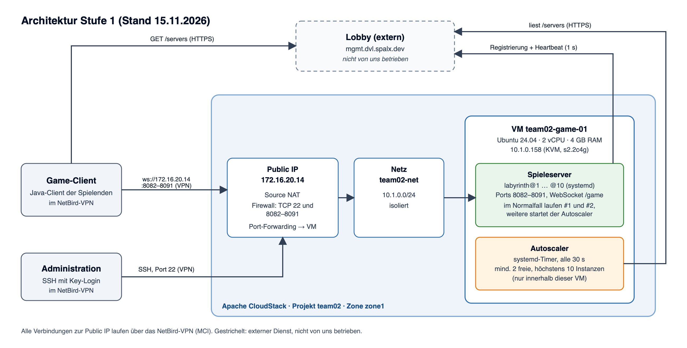

# Technischer Statusbericht Stufe 1: Run it in the Cloud

**Team 02** · Cloud Application Project WS 2026/27 · MCI Master DiBSE

**Autor:innen:** Miralem Djedovic, Fabian Egger, Clemens Huber, Romed Kelmer, Thomas Klammer, Christian Plattner

**Betreuer:** Hasenjäger · **Stand:** 15.11.2026 · **Abgabe:** 23.11.2026 · **Präsentation:** 26.11.2026

---

## 1. Zielerreichung

**Aufgabe der Stufe:** Eine funktionierende, über Web und Game-Client erreichbare Spieleserver-Anwendung auf einer CloudStack-VM, mit kontrolliertem Zugriff. Ziele: IaaS, Compute, Networking, IAM, Sicherheit (5), Datenschutz (6), Betrieb und Dokumentation (10).

**Kurzfassung:** Der Spieleserver „Das Verrückte Labyrinth“ läuft seit dem 09.11.2026 auf der VM `team02-game-01` und ist mit dem Game-Client über das VPN spielbar. Ein Testspiel mit drei Spielern lief am 11.11. von der Lobby bis zum Spielende. Am 15.11. wurde nachgemessen: Von außen kommen nur die Ports 22 und 8082–8091 durch die Firewall, SSH akzeptiert nur Keys, und nach einem Neustart der VM sind die Spieleserver nach etwa 27 Sekunden ohne Eingriff wieder in der Lobby. Offen sind der Absturztest (Z5), die Einschränkung der Firewall und die Verschlüsselung der Verbindung.

### Zielwerte

| Nr. | Zielwert | Status |
|---|---|---|
| Z1 | Ein Spiel mit mehreren Spielern läuft über die Cloud-VM von der Lobby bis zum Spielende. | **erreicht** (Test vom 11.11., 3 Spieler, laut Betriebsprotokoll, Abschnitt 4.2) |
| Z2 | Von außen sind genau die TCP-Ports 22 und 8082–8091 erreichbar, sonst nichts. | **erreicht** (15.11.): Portscan der Ports 1–10000 mit `nc` und mit `nmap`, nur 22 und 8082–8091 kommen durch die Firewall (davon lauschen zum Messzeitpunkt 22, 8082, 8084), 9.989 Ports gefiltert (Abschnitt 4.3) |
| Z3 | SSH-Login mit Passwort wird abgelehnt, nur Key-Login geht. | **erreicht** (15.11.): SSH bietet von außen nur `publickey` an, Passwort-Login wird abgelehnt (Abschnitt 4.4) |
| Z4 | Nach einem Neustart der VM sind die Spieleserver ohne Eingriff wieder in der Lobby. | **erreicht** (15.11.): nach einem normalen Neustart ca. 27 s bis zum neuen Lobby-Eintrag (Abschnitt 4.5) |
| Z5 | Stürzt der Serverprozess ab, startet er selbst neu. | **noch offen:** konfiguriert (`Restart=on-failure`, 5 s), der Absturztest steht aus (Abschnitt 4.6) |

### Erreichungsgrad je Ziel der Stufe

| Ziel | Stand | Beleg |
|---|---|---|
| **IaaS / Compute** | **erreicht.** VM `team02-game-01`, Ubuntu 24.04, 2 vCPU, 4 GB RAM (`s2.2c4g`), Zustand Running. | CloudStack |
| **Game-Client** | **erreicht**, nur über VPN. Der Client holt die Serverliste bei der Lobby und verbindet sich mit `ws://172.16.20.14:<Port>`. | Lobby, Messung |
| **Web** | **erreicht.** Der Server ist über Web-Technologien erreichbar: HTTPS-Lobby für die Serverliste und WebSocket-Verbindung für den Game-Client. Ein zusätzliches Web-Frontend ist laut Rückfrage beim Betreuer nicht gemeint. | Repo, Lobby |
| **Networking** | **erreicht.** Isoliertes Netz `team02-net` (10.1.0.0/24), Source NAT über `172.16.20.14`, Firewall und Port-Forwarding für 22 und 8082–8091. | CloudStack |
| **Kontrollierter Zugriff** | **teilweise.** Erreichbar nur über VPN oder Hochschulnetz, weil `172.16.20.14` eine private Adresse ist. Von außen kommen nur die Ports 22 und 8082–8091 durch, SSH bietet nur `publickey` an. Die Firewall-Quelle ist `0.0.0.0/0`, die Einschränkung ist offen. Das VPN ist eine MCI-Einrichtung, kein eigener Schutz des Teams. | CloudStack, Messung |
| **IAM** | **erreicht.** Je Person ein eigener Benutzer und Key auf der VM, Passwort-Login aus, Zugang einzeln entziehbar (laut Betriebsanleitung). | Betriebsanleitung |
| **Sicherheit (5)** | **teilweise.** Dienst als eigener System-User ohne Login-Shell, Systemupdates am 11.11. eingespielt (laut Betriebsanleitung), SSH-Passwort-Login von außen abgelehnt, Git-Historie auf Zugangsdaten geprüft (Abschnitt 4.8). Offen: unverschlüsselte Verbindung (`ws://`) und Firewall-Quelle. | Betriebsanleitung, Messung, Repo, Lobby |
| **Datenschutz (6)** | **erreicht im Rahmen des Projekts.** Es werden nur die für den Spielbetrieb nötigen Daten verarbeitet, siehe Abschnitt 2. | Lobby, Repo |
| **Betrieb und Doku (10)** | **erreicht.** Nach einem Neustart der VM sind die Spieleserver ohne Eingriff nach ca. 27 s wieder in der Lobby (gemessen). Neustart bei Fehler über systemd konfiguriert, Logs im Journal, Architekturdiagramm vorhanden. Eine Betriebsanleitung für das Anlegen, den Betrieb und das Einspielen neuer Versionen liegt vor und kann bei Bedarf nachgereicht werden. | Messung, Betriebsanleitung |

**Vorgriff auf Stufe 3:** Auf der VM laufen bis zu 10 Spielinstanzen, ein Autoscaler startet und stoppt sie nach Bedarf (Abschnitt 2). Das ist **kein** Nachweis für Elastizität im Sinne von Stufe 3, weil es nur innerhalb einer VM skaliert.

---

## 2. Umsetzung und Entscheidungen

### Vorgehen

Die Ressourcen wurden im Projekt `team02` über die Web-Oberfläche und die API (`cloudmonkey`) von Hand angelegt. Die Befehle sind in der Betriebsanleitung festgehalten. Infrastruktur als Code folgt in Stufe 2.

### Entscheidungen

| Entscheidung | Begründung | Beleg |
|---|---|---|
| **Isoliertes Netz mit Source NAT, Port-Forwarding und Firewall** | Die VM liegt im privaten Netz. Eine Firewall-Regel allein reicht nicht, erst das Port-Forwarding leitet den Port an die VM. | CloudStack, Betriebsanleitung |
| **Ubuntu 24.04 LTS, Java 25 aus dem Paket `openjdk-25-jre-headless`** | Der Server braucht Java 25. Die Variante ohne Oberfläche reicht. | Betriebsanleitung |
| **JAR lokal bauen und per `scp` hochladen** | Kein Build auf der VM. Das spart RAM und hält die VM schlank. | Betriebsanleitung |
| **systemd-Dienst, eigener System-User ohne Login-Shell** | Autostart, Neustart nach Absturz, Logs im Journal. Bei einer Lücke ist nur dieser User betroffen. | Betriebsanleitung |
| **Keypair beim Deploy mitgeben** | cloud-init übernimmt Keys nur beim ersten Boot. Bei der ersten Test-VM führte ein nachträglich zugewiesener Key zu `Permission denied`. | Betriebsanleitung |
| **Ein Benutzer und ein Key je Person, Passwort-Login aus** | Nachvollziehbar, wer was getan hat. Zugang einzeln entziehbar. | Betriebsanleitung |
| **`server.publichost` = Public IP `172.16.20.14`** | Diese Adresse meldet der Server der Lobby, die Clients verbinden sich damit. Die interne 10.1.0.158 wäre nicht erreichbar. | Betriebsanleitung, Lobby |
| **Mehrere Prozesse statt mehrerer Spiele pro Prozess** | Der Server verwaltet pro Prozess genau ein Spiel (`GameService` mit einem `Game`). Mehrere Prozesse brauchen keine Code-Änderung und bleiben mit den Clients der anderen Gruppen kompatibel. | Repo, Betriebsanleitung |
| **VM von 1 vCPU/1 GB auf 2 vCPU/4 GB vergrößert; bis zu 10 Instanzen mit je 256 MB Heap** | Eine Instanz braucht im Leerlauf ca. 180–230 MB, zehn zusammen ca. 1,9 GB. 100 Instanzen wurden verworfen (ca. 20 GB RAM, Projektlimit 12 GB, Lobby überladen). | CloudStack, Betriebsanleitung |
| **Autoscaler als systemd-Timer (alle 30 s)** | Hält immer 2 freie Instanzen bereit, stoppt überzählige nach 5 min Leerlauf, nie unter 2 laufende. Liest den Zustand aus der Lobby (`/servers`). | Betriebsanleitung |

### Rahmen der Plattform

Aus der Plattform-Dokumentation (`docs.cloud.dibse.at`, Stand 15.11.2026) folgt für unsere Entscheidungen:

- Es gibt **kein Kubernetes als Dienst** und **keine Backups einzelner VMs**, nur Snapshots.
- Die Plattform läuft auf **einem Server**. Fällt er aus, stehen alle VMs. Hochverfügbarkeit ist deshalb nur auf VM- und Prozess-Ebene möglich, nicht auf Host-Ebene.
- Load Balancer, Autoscaling-Gruppen, VM-Snapshots und OpenTofu (mit S3-Bucket für den State) sind freigeschaltet, wir haben sie noch nicht erprobt.
- Limits je Team (seit 12.11.): 7 VMs, 12 vCPU, 12 GB RAM, 200 GB Speicher, 3 Public-IPs. **Belegt:** 1 VM, 2 vCPU, 4 GB RAM, 20 GiB Speicher, 1 Public-IP (CloudStack, 15.11.).

### Datenschutz

Für den Projektrahmen angemessen verarbeitet der Spieleserver nur die Daten, die für den Spielbetrieb nötig sind:

- **Spielstand und Spielernamen** liegen laut Betriebsanleitung nur im Arbeitsspeicher und sind nach einem Neustart weg.
- **Lobby (extern):** Der Eintrag eines Servers enthält Servername, WebSocket-Adresse, maximale und aktuelle Spielerzahl, Status, ID und Zeitstempel. Die Lobby ist ein Dienst Dritter.
- **Zugriff auf die VM** haben nur die Teammitglieder per SSH-Key über das VPN.
- **Im Repo** wurden keine personenbezogenen E-Mail-Adressen gefunden (Abschnitt 4.8).

---

## 3. Architektur



*Abbildung 1: Architektur Stufe 1 (Stand 15.11.2026).*

### CloudStack-Dienste und Ressourcen

| Ressource | Wert |
|---|---|
| Projekt / Zone | `team02` / `zone1` (Advanced-Netzwerk) |
| Netz | `team02-net`, Isolated, 10.1.0.0/24, Offering `isolated-internet` |
| Public IP | `172.16.20.14` (Source NAT) |
| VM | `team02-game-01`, KVM, `s2.2c4g`, Template Ubuntu 24.04 LTS (Cloud-Image 20261017), 20-GiB-Systemplatte |
| SSH-Keypair | `team02-key` |
| Firewall | TCP 22 und TCP 8082–8091 von `0.0.0.0/0` |
| Port-Forwarding | 22 → VM:22 und 8082–8091 → VM:8082–8091 |

*Abbildung 2: CloudStack-Ansichten der VM `team02-game-01`, der Firewall-Regeln und des Port-Forwardings: noch offen.*

### Technologien und Abhängigkeiten

- **Anwendung:** Java 25, Spring Boot 3.5.7, WebSocket-Endpunkt `/game`, Maven-Module `Contracts`, `ManagementClient`, `Client`, `Server` (Repo). Der Spielstand liegt laut Betriebsanleitung nur im Arbeitsspeicher (H2 in-memory).
- **Lobby (extern, nicht unser Dienst):** Die Instanzen registrieren sich dort und die Clients holen die Serverliste. Ohne Lobby finden Clients unsere Server nicht, auch der Autoscaler liest von dort.
- **VPN (NetBird, von MCI):** Ohne VPN ist die Public IP nicht erreichbar.
- **CloudStack-Plattform (MCI):** Läuft auf einem Server, siehe Abschnitt 2.
- **GitHub:** Repo `labyrinth` mit CI (Bauen und Testen mit GitHub Actions). Ein Deploy-Schritt war im gelesenen Teil der Pipeline nicht zu sehen.

---

## 4. Verifikation

Die Messungen vom 15.11.2026 wurden von einem Laptop im NetBird-VPN gegen die eigene Public IP `172.16.20.14` durchgeführt. Alle Uhrzeiten sind MEZ.

### 4.1 Übersicht der Tests

Die Abschnitte 4.2 bis 4.6 folgen den Zielwerten Z1 bis Z5, Abschnitt 4.7 und 4.8 enthalten weitere Prüfungen. Was noch nicht erledigt ist, steht mit „noch offen“ an der Stelle, an der das Ergebnis später hingehört.

| Datum | Test | Ergebnis | Beleg |
|---|---|---|---|
| 09.11. | Dienst gestartet, Lobby, Client-Verbindung | Dienst `active`, Lobby zeigt `Team02 Cloud`, Client verbindet sich | Betriebsprotokoll |
| 11.11. | Neustart der VM | Dienst lief wieder von selbst | Betriebsprotokoll |
| 11.11. 19:42 | Protokolltest, 2 Spieler (WebSocket-Skript) | Beide bekommen `CONNECT_ACK`, danach ist die Lobby leer, keine hängenden Sitzungen | Betriebsprotokoll |
| 11.11. 19:44 | Echter Client, 1 Spieler | Verbindung zu „Team02 Cloud“, sauber getrennt | Betriebsprotokoll |
| 11.11. 19:45–19:46 | **Echter Client, 3 Spieler gleichzeitig** | Spiel bis `GAME_OVER` gespielt (Gewinner Test3), alle zurück in die Lobby, sauber getrennt | Betriebsprotokoll, Abschnitt 4.2 |
| 11.11. 20:11–20:16 | Autoscaler (Leerlauf, Neustart, Spieler verbindet sich) | Stoppt #10, #9, #8; nach VM-Neustart laufen nur #1 und #2; nach Verbindung auf #1 startet er um 20:16:45 #3 | Betriebsprotokoll |
| 15.11. | Abgleich Dokumentation ↔ CloudStack | VM, Firewall, Port-Forwarding, Keypair und Netz stimmen mit der Dokumentation überein | CloudStack |
| 15.11. | Portscan (Z2) | Nur 22 und 8082–8091 kommen durch die Firewall | Abschnitt 4.3 |
| 15.11. | SSH-Probe (Z3) | Nur `publickey` wird angeboten | Abschnitt 4.4 |
| 15.11. | WebSocket-Handshake | `101 Switching Protocols` | Abschnitt 4.7 |
| 15.11. | Neustart der VM (Z4) | Lobby nach 27 s wieder da | Abschnitt 4.5 |
| noch offen | Absturz eines Serverprozesses (Z5) | noch offen | Abschnitt 4.6 |
| 15.11. | Git-Historie auf Zugangsdaten durchsucht | Keine privaten Schlüssel, Tokens oder E-Mail-Adressen | Abschnitt 4.8 |

### 4.2 Z1: Spiel mit mehreren Spielern

**Methode:** Drei Instanzen des echten Game-Clients (Test1 bis Test3) verbinden sich über das VPN mit „Team02 Cloud“ und spielen ein Spiel von der Lobby bis zum Spielende.

**Ergebnis** (Test vom 11.11., 19:45–19:46 Uhr, laut Betriebsprotokoll): Das Spiel mit 3 Spielern wurde bis `GAME_OVER` gespielt (Gewinner Test3, alle 6 Schätze). Danach waren alle Spieler zurück in der Lobby und sauber getrennt. Davor liefen ein Protokolltest mit 2 Spielern (19:42 Uhr) und ein Test mit 1 Spieler (19:44 Uhr).

**Bewertung:** **Z1 ist erfüllt.**

**Grenzen:** Ein einzelnes Testspiel mit 3 Spielern. Ein Beleg als Screenshot fehlt noch.

*Abbildung 3: Testspiel mit drei Spielern bis zum Spielende: noch offen.*

### 4.3 Z2: Portscan der eigenen Public IP

**Methode:** TCP-Verbindungsversuch auf alle Ports 1 bis 10000, zuerst mit `nc -vz` (1 s Timeout, 64 parallel, 09:54–09:57 Uhr), danach als Wiederholung mit `nmap -Pn -sT -p 1-10000 -T4 --max-retries 1 --reason` (10:02–10:09 Uhr, 447 s, Latenz 0,038 s). Gescannt wurde nur die eigene IP.

| Zustand | Ports | Anzahl |
|---|---|---|
| **offen** | 22, 8082, 8084 | 3 |
| **refused** (Port erreicht die VM, dort lauscht nichts) | 8083, 8085–8091 | 8 |
| **gefiltert** (Timeout, von der Firewall verworfen) | alle übrigen | 9.989 |

Auszug der nmap-Ausgabe:

```
Not shown: 9989 filtered tcp ports (no-response)
PORT      STATE   REASON
22/tcp    open    syn-ack
8082/tcp  open    syn-ack
8083/tcp  closed  conn-refused
8084/tcp  open    syn-ack
8085/tcp  closed  conn-refused
8086/tcp  closed  conn-refused
8087/tcp  closed  conn-refused
8088/tcp  closed  conn-refused
8089/tcp  closed  conn-refused
8090/tcp  closed  conn-refused
8091/tcp  closed  conn-refused
```

**Bewertung:** Beide Werkzeuge liefern dasselbe Ergebnis. Im Bereich 1–10000 passieren nur 22 und 8082–8091 die Firewall. **Z2 ist erfüllt.** Zum Messzeitpunkt lauschten von den zehn Spielports nur 8082 (Instanz #1) und 8084 (Instanz #3).

**Grenzen:** Nur TCP, nur Ports 1–10000, eine Messung. „Gefiltert“ bedeutet Timeout, kurze Paketverluste könnten einzelne Ports theoretisch falsch einordnen. Die Dienstnamen in der nmap-Ausgabe rät nmap nur aus der Portnummer, sie sind hier weggelassen.

### 4.4 Z3: SSH ohne Zugangsdaten

**Methode:** SSH-Verbindung als `ubuntu` ohne Zugangsdaten, die Passwort-Methode wurde erzwungen (`-o PubkeyAuthentication=no -o PreferredAuthentications=password -o BatchMode=yes`).

```
debug1: Remote protocol version 2.0, remote software version OpenSSH_9.6p1 Ubuntu-3ubuntu13.20
debug1: Authentications that can continue: publickey
ubuntu@172.16.20.14: Permission denied (publickey).
```

**Bewertung:** Der Server bietet nur `publickey` an, ein Passwort-Login ist nicht möglich. **Z3 ist erfüllt** (von außen nachgewiesen). Die Einstellung in der `sshd_config` selbst ist damit nicht gezeigt. Der ED25519-Host-Key der VM stimmt mit dem in der Betriebsanleitung dokumentierten überein und war nach dem Neustart unverändert.

### 4.5 Z4: Neustart der VM

**Methode:** Ein Skript prüfte ab 10:13:02 jede Sekunde TCP-Verbindungen auf die Ports 22, 8082, 8083 und 8084 und alle drei Sekunden die Lobby. Vorab um 10:19:53 standen beide Team-02-Instanzen auf `LOBBY` mit 0 Spielern. Der Neustart wurde in CloudStack mit „Reboot Instance“ ausgelöst (normal, ohne Force). Die CloudStack-Events zeigen `VM.REBOOT` Scheduled und Started um 10:20:01 und Completed um 10:20:02.

| Uhrzeit | Ereignis | seit Klick (ca.) |
|---|---|---|
| 10:20:01 | Neustart ausgelöst (Event) | 0 s |
| 10:20:02 | Ports 8082 und 8084 verweigern Verbindungen, die Server beenden sich | +1 s |
| 10:20:03 | Port 22 nicht mehr erreichbar. Beide Lobby-Einträge verschwinden sofort (Abmeldung beim Herunterfahren) | +2 s |
| 10:20:20 | Netz der VM wieder da (Ports `refused`, noch kein Dienst) | +19 s |
| 10:20:22 | **Port 22 (SSH) wieder offen** | +21 s |
| 10:20:29 | **Port 8082 (#1) und 8083 (#2) offen** | +28 s |
| 10:20:31 | **Erste neue Heartbeats in der Lobby (#1 und #2)** | +30 s |
| 10:23:33 | Kontrolle: Port 22, 8082, 8083 offen, 8084 `refused`. Lobby: #1 und #2 `LOBBY`, 0 Spieler | – |

**Ausfall von außen** (erster Fehlversuch auf Port 22 um 10:20:03): SSH nach **19 s**, Spieleserver nach **25 s**, Lobby nach **27 s** (Auflösung 1 s, Lobby-Abfrage alle 3 s).

**Bewertung:** Die Spieleserver sind nach einem normalen Neustart **ohne Eingriff nach etwa 27 Sekunden wieder in der Lobby** (30 s ab Klick). **Z4 ist erfüllt.**

**Weitere Beobachtungen:**

- Die Instanzen **melden sich beim Herunterfahren selbst von der Lobby ab**, es blieben keine veralteten Einträge stehen.
- **Instanz #3 (8084)** startete bis 10:23 nicht neu. Das passt zum beschriebenen Verhalten des Autoscalers: Bei zwei freien Instanzen startet er keine weitere.
- Der **SSH-Host-Key** ist unverändert, es ist dieselbe VM.

**Grenzen:** Eine einzelne Messung eines **normalen Neustarts** (ACPI) ohne laufendes Spiel, kein Absturz und kein Stromausfall. Die Uhren des Laptops und von CloudStack können um Sekunden abweichen, das Event um 10:20:01 und der Ausfall um 10:20:02/03 passen aber zusammen.

### 4.6 Z5: Absturz eines Serverprozesses

**Methode (geplant):** Ein Serverprozess wird ohne laufendes Spiel mit `kill` beendet (z. B. `sudo systemctl kill -s SIGKILL labyrinth@1`). Das Journal (`journalctl -u labyrinth@1`) zeigt, ob und nach welcher Zeit der Dienst neu startet. Konfiguriert ist `Restart=on-failure` mit 5 s Wartezeit.

**Ergebnis:** noch offen

**Bewertung:** noch offen

### 4.7 Erreichbarkeit: WebSocket-Handshake und Client-Verbindung

HTTP-Upgrade auf `ws://172.16.20.14:8082/game` (09:54 Uhr):

```
HTTP/1.1 101
Upgrade: websocket
Connection: upgrade
{"type":"SERVER_INFO","serverVersion":"1.0.0","protocolVersion":"1.0.0","motd":"Welcome to the aMAZEing Game Server!"}
```

**Bewertung:** Der Spieleserver ist über das VPN erreichbar und antwortet mit `101 Switching Protocols` und seiner Server-Info. Das belegt die Erreichbarkeit, nicht ein ganzes Spiel (Z1, siehe Abschnitt 4.2).

**Client-Verbindung:** Der Game-Client holt die Serverliste bei der Lobby und verbindet sich mit „Team02 Cloud / Autoscale #N“ (Tests vom 11.11., laut Betriebsprotokoll).

*Abbildung 4: Game-Client mit Verbindung zu „Team02 Cloud“: noch offen.*

### 4.8 Git-Historie auf Zugangsdaten durchsucht

Die gesamte Historie des öffentlichen Repos `labyrinth` (417 Commits, alle Branches) wurde mit einer Mustersuche auf private Schlüssel, Cloud- und GitHub-Tokens, Passwörter und Zugangsdaten in URLs durchsucht. Ergebnis: keine privaten Schlüssel, Tokens oder personenbezogenen E-Mail-Adressen. Gefunden wurde ein im Klartext hinterlegter Standardwert für ein Deploy-Token in `Labyrinth.Server/deploy.js`, das unser Aufbau nicht nutzt. Grenzen: Die Suche ist kein spezialisiertes Werkzeug und garantiert keine Vollständigkeit, Binärdateien wurden nicht geprüft.

---

## 5. Offene Punkte und Reflexion

### Offene Punkte und Risiken

| Punkt | Einordnung |
|---|---|
| **Absturztest (Z5)** | Noch offen, siehe Abschnitt 4.6. |
| **Firewall-Quelle `0.0.0.0/0`** | Eingeschränkt wird in Stufe 2 auf das VPN- und Hochschulnetz. Die Plattform-Doku nennt für VPN-Clients das Netz `10.98.0.0/16` als Quelle. Heute schützt nur die private Adresse. |
| **Unverschlüsselte Verbindung** | Clients verbinden sich mit `ws://`. TLS würde einen vorgeschalteten Proxy und ein Zertifikat brauchen. |
| **Fehler im Spielcode** | `NextTreasureCardListener` übergibt `event.treasureCard()` ohne Null-Prüfung. Die Exception wird abgefangen und geloggt, das Spiel läuft weiter. Behebung: Prüfung vor dem Versand. |
| **Standard-Token im Deploy-Skript** | Gefunden beim Scan der Git-Historie (Abschnitt 4.8). Unser Aufbau nutzt das Skript nicht. Das Token gehört aus dem Code entfernt, ist der Endpunkt noch aktiv, auch geändert. |
| **Öffentliches Repo** | `labyrinth` ist öffentlich. Die Betriebsanleitung im Branch `cloud-project` nennt Benutzernamen, die sudo-Einrichtung ohne Passwort, Ressourcen-IDs, interne Adressen und den Host-Fingerprint, aber keine privaten Keys. Das Risiko ist wegen der VPN-Adressen begrenzt. Ob sie dort bleibt, ist noch offen. |
| **Spielstand nur im Speicher** | Nach einem Neustart oder Absturz weg. Persistenz folgt in Stufe 2. |
| **Abhängigkeit von der externen Lobby** | Verfügbarkeit und Datenschutz liegen nicht in unserer Hand. Auch der Autoscaler liest von dort. |
| **Plattform auf einem Server** | Keine Hochverfügbarkeit auf Host-Ebene. Das begrenzt, was in Stufe 3 erreichbar ist. |
| **Autoscaler** | Skaliert nur in einer VM, läuft als root und liest von der externen Lobby. |
| **VPN für die Präsentation** | Alle Beteiligten brauchen VPN. Die Anmeldung läuft nach 7 Tagen ab, vorher testen. |

### Nächste Schritte (Stufe 2, Abgabe 14.12., Präsentation 17.12.)

- Infrastruktur als Code mit OpenTofu, State in einem S3-Bucket mit Sperre
- Containerisierung: Der Branch `docker` enthält bereits `Dockerfile` und `docker-compose.yml`
- CI/CD erweitern: Die Pipeline baut und testet, deployt aber noch nicht
- Persistenter Speicher und Snapshot mit Restore-Test
- Monitoring und Alarm, Firewall einschränken, TLS prüfen

### Reflexion

Der Aufbau hat gezeigt, dass viele Fehler an Kleinigkeiten lagen, die erst beim zweiten Versuch klar wurden:

| Problem | Ursache | Lösung |
|---|---|---|
| Erste Test-VM per SSH nicht erreichbar (`Permission denied`) | Ohne Keypair deployt, Key nachträglich zugewiesen. cloud-init übernimmt ihn nur beim ersten Boot. | VM gelöscht, mit `keypair=team02-key` neu deployt |
| SSH auf `172.16.20.14` läuft in einen Timeout | Die „Public IP“ ist eine private Adresse | VPN verwenden |
| `Service offering is inactive` beim Deploy | Die `s1.*`-Angebote wurden deaktiviert | Nur noch `s2.*` |
| Client zeigt keine Server, `MalformedURLException` | `ws://...` im Feld „Server URL“ eingetragen | Dort gehört die Lobby `https://mgmt.dvl.spalx.dev` hin |
| Erstes JAR enthielt den Fix #74 (stale connections) nicht | Es war 9 Minuten vor dem Fix-Commit gebaut worden | JAR aus dem aktuellen Stand neu gebaut |

Gelernt haben wir außerdem: Die Plattform hatte am 11.11. einen Ausfall, der alle Teams betraf. Verfügbarkeit hängt auch von Dingen ab, die wir nicht steuern. In Stufe 2 und 3 muss der Bericht daher sauber trennen zwischen dem, was unser Aufbau leistet, und dem, was die Plattform vorgibt.
